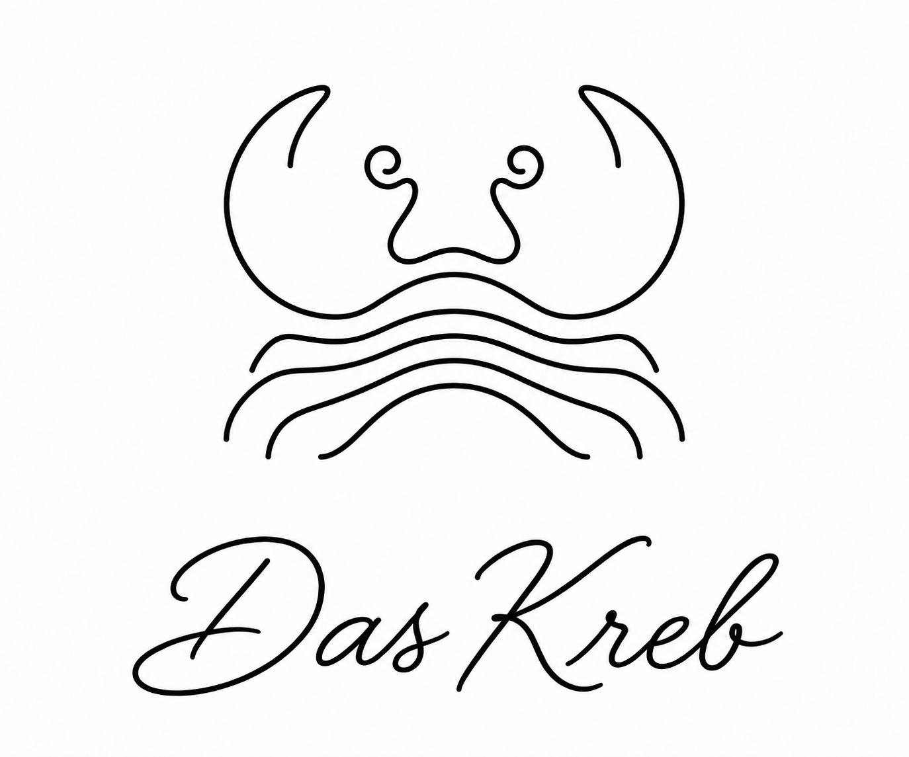

# MyFitnessPal MCP

<p align="center"></p>

<p align="center"><strong>MyFitnessPal diary, nutrition, food estimation, and reviewed account updates for MCP clients.</strong></p>

<p align="center"><a href="https://github.com/myke239/myfitnesspal-mcp/releases/latest">Releases</a> · <a href="docs/getting-started.md">Installation guide</a> · <a href="docs/shared-ngrok.md">Shared ngrok setup</a> · <a href="docs/tool-guide.md">Tool guide</a></p>

[](https://github.com/myke239/myfitnesspal-mcp/actions/workflows/ci.yml) [](https://github.com/myke239/myfitnesspal-mcp/releases/latest) [](LICENSE)

A local-first MCP server for MyFitnessPal. Connect through stdio on Windows, macOS, or Linux, or expose it through the authenticated HTTPS gateway for ChatGPT and mobile. It uses the unofficial [`python-myfitnesspal`](https://github.com/coddingtonbear/python-myfitnesspal) client; upstream website changes, browser protections, or account restrictions can affect availability.

## Quick start

1. Download the latest release for your platform: the Windows setup app, or `install.sh` for macOS/Linux.
2. Run it and follow the short on-screen steps. Windows users do not need Python or a terminal.

See the [quick installation guide](docs/getting-started.md). No password is stored by this project; browser session cookies are read locally.

## What it can do

- Read diary entries, nutrients, water, exercise, measurements, goals, recipes, saved meals, and account preferences.
- Search foods and serving sizes; estimate nutrition and edible weight from food images without changing the diary.
- Make explicitly requested diary and account updates using idempotency keys, exact schemas, and read-back guidance.
- Connect remotely over OAuth with separate read/write grants and local approval for sensitive operations.

Writes are available by default locally. Remote write access requires an explicit OAuth write grant. See the tool guide and [write safety notes](docs/write-safety.md). This is not full MyFitnessPal website feature parity, and live upstream write persistence may vary.

## One ngrok HTTPS address for multiple connectors

You can run Garmin and MyFitnessPal through the **same ngrok HTTPS hostname**. Garmin uses `/mcp/garmin-connect`; MyFitnessPal uses `/mcp/myfitnesspal`. The URLs share scheme, hostname, and ngrok tunnel; each connector uses its own ending path and isolated OAuth state. Do not start a second tunnel or substitute a second hostname for this setup. Follow [Shared ngrok setup](docs/shared-ngrok.md).

## Platforms and releases

The local connector supports Windows, macOS, and Linux. Windows releases include a guided setup app; macOS/Linux use the install script and require Python 3.11+. Browser cookie access depends on supported browsers and OS keychain protections. The combined Garmin + MyFitnessPal HTTPS gateway currently uses Windows DPAPI and its supplied PowerShell launcher, so remote ChatGPT/mobile setup is Windows-hosted today.

## Development

```bash
python -m venv .venv
# Windows: .venv\\Scripts\\python -m pip install -e ".[dev]"
# macOS/Linux: .venv/bin/python -m pip install -e ".[dev]"
python -m pytest
python -m ruff check src tests
python -m build
```

## License and attribution

Source code is MIT licensed. Das Kreb branding is included from the companion [Garmin Connect MCP](https://github.com/myke239/garmin-connect-mcp) project. Third-party software notices are in [THIRD_PARTY_NOTICES.md](THIRD_PARTY_NOTICES.md).

