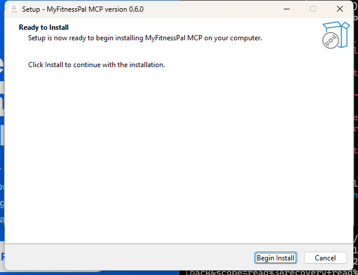
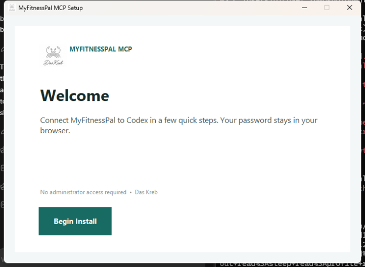
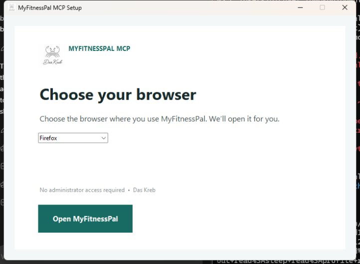
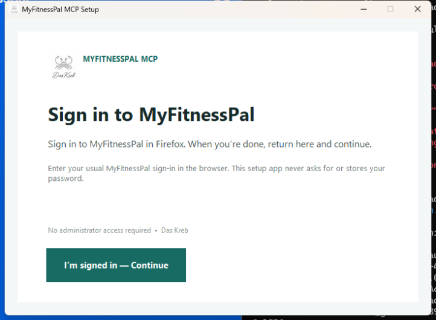

# Install MyFitnessPal MCP

## Windows

1. Install and sign in to the [Codex desktop app](https://developers.openai.com/codex/quickstart), and install Firefox, Chrome, or Edge.
2. Download and open [MyFitnessPal MCP Setup](https://github.com/myke239/myfitnesspal-mcp/releases/latest/download/myfitnesspal-mcp-windows-x64-setup.exe). If Windows asks, choose **More info → Run anyway**.
3. Click **Begin Install** in the Windows installer.

   

4. When the setup app opens, click **Begin Install**.

   

5. Keep the browser where you use MyFitnessPal selected, then click **Open MyFitnessPal**.

   

6. Sign in in the browser. Return to setup and click **I’m signed in — Continue**.

   

7. When you see **You’re all set**, close and reopen Codex and start a new chat.

**Installed correctly:** MyFitnessPal appears in Codex’s plugin list. In a new chat, ask: “Show my MyFitnessPal food diary for yesterday.”

The setup app checks your browser session and installs the plugin automatically. It never asks for your MyFitnessPal password. If Codex is not installed yet, install it and open **MyFitnessPal MCP Setup** from the Start menu.

## macOS or Linux

1. Install Python 3.11 or newer and Firefox, then sign in to MyFitnessPal in Firefox.
2. Download `install.sh` from [the latest release](https://github.com/myke239/myfitnesspal-mcp/releases/latest).
3. In Terminal, go to Downloads and run:

   ```sh
   chmod +x ./install.sh && ./install.sh
   ```

4. Follow the printed instructions to verify your browser session and add the server to your MCP client.

**Installed correctly:** ask your MCP client to show your MyFitnessPal food diary for yesterday.

## Shared ngrok setup

To use Garmin Connect and MyFitnessPal through one ngrok HTTPS address, follow [Shared ngrok setup](shared-ngrok.md). Keep the same HTTPS hostname and use `/mcp/garmin-connect` for Garmin and `/mcp/myfitnesspal` for MyFitnessPal.
