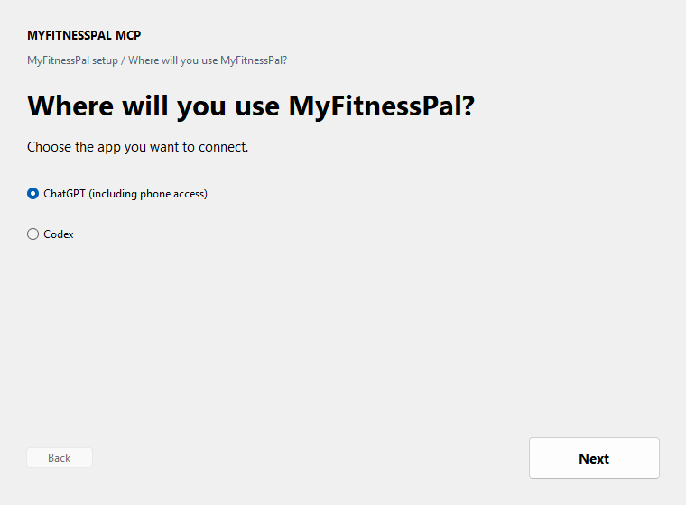
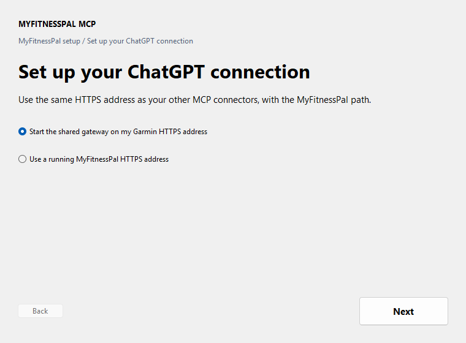
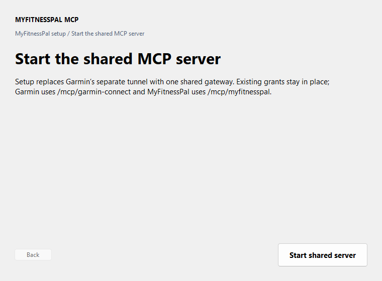
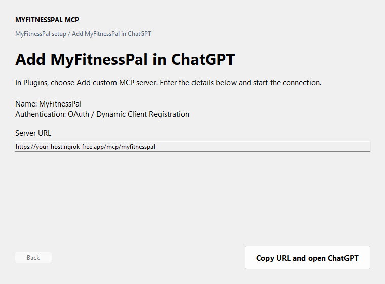

# Install MyFitnessPal MCP

## Windows

1. Download and open [MyFitnessPal MCP Setup](https://github.com/myke239/myfitnesspal-mcp/releases/latest/download/myfitnesspal-mcp-windows-x64-setup.exe). If Windows asks, choose **More info → Run anyway**.
2. Click **Begin Install** in the Windows installer.

   

3. When the setup app opens, click **Begin Install**.

   

4. Choose the browser where you use MyFitnessPal, then click **Open MyFitnessPal**. Sign in and return to setup.

   

5. Click **Verify MyFitnessPal**. When verification succeeds, choose **ChatGPT (including phone access)** or **Codex**.

   

   

### ChatGPT setup

1. Choose **Start the shared gateway on my Garmin HTTPS address**, then click **Start shared server**. If the shared gateway is already running, choose **Use a running MyFitnessPal HTTPS address** instead. MyFitnessPal uses `/mcp/myfitnesspal`; Garmin keeps `/mcp/garmin-connect`.

   

   
2. Click **Copy URL and open ChatGPT**. In Plugins, choose **Add custom MCP server**, paste the copied URL, choose OAuth / Dynamic Client Registration, and start the connection.
3. Copy the connection code shown in the browser and paste it into setup. Review the access, then click **Approve connection**.
4. Return to the browser and click **Continue**. Finish installing the connector in ChatGPT, return to setup, then click **Verify connection**.

   

**Installed correctly:** Setup shows **You’re connected**. In a new ChatGPT chat, ask: “Show my MyFitnessPal food diary for yesterday.”

The shared gateway needs Garmin Connect MCP installed and connected on this PC. The wizard switches the existing Garmin tunnel to one shared gateway so both connectors use the same HTTPS address. Keep this PC awake for ChatGPT access.

### Codex setup

1. Choose **Codex**, then click **Connect Codex**.
2. When setup shows **You’re connected**, close and reopen Codex and start a new chat.

**Installed correctly:** MyFitnessPal appears in Codex’s plugin list. In a new chat, ask: “Show my MyFitnessPal food diary for yesterday.”

The setup app checks your browser session and installs the plugin automatically. It never asks for your MyFitnessPal password. If Codex is not installed yet, install it and open **MyFitnessPal MCP Setup** from the Start menu.

## macOS or Linux

1. Install Python 3.11 or newer and Firefox, then sign in to MyFitnessPal in Firefox.
2. Download `install.sh` from [the latest release](https://github.com/myke239/myfitnesspal-mcp/releases/latest).
3. In Terminal, go to Downloads and run:

   ```sh
   chmod +x ./install.sh && ./install.sh
   ```

4. Follow the printed instructions to verify your browser session and add the server to your MCP client.

**Installed correctly:** ask your MCP client to show your MyFitnessPal food diary for yesterday.

## Shared ngrok setup

To use Garmin Connect and MyFitnessPal through one ngrok HTTPS address, follow [Shared ngrok setup](shared-ngrok.md). Keep the same HTTPS hostname and use `/mcp/garmin-connect` for Garmin and `/mcp/myfitnesspal` for MyFitnessPal.
