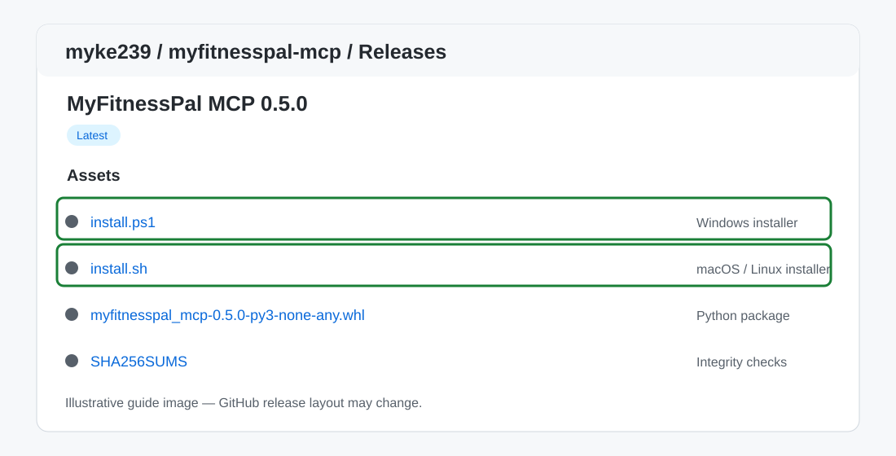
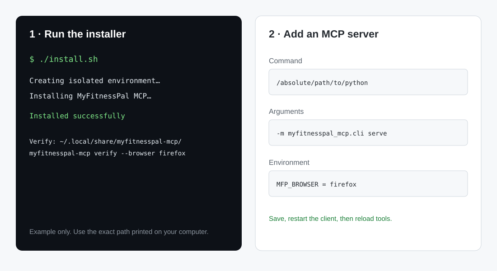
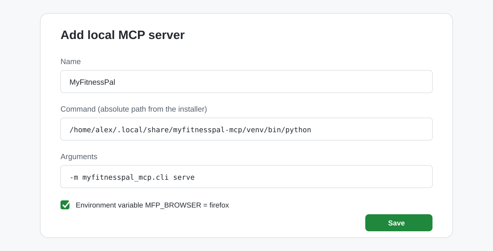

# Step-by-step installation

This guide installs the latest published MyFitnessPal MCP release on Windows, macOS, or Linux. It does not require cloning the repository. You need Python 3.11+, an MCP client, and Firefox signed in to MyFitnessPal for local authentication.

## 1. Download the installer

Open [Releases](https://github.com/myke239/myfitnesspal-mcp/releases/latest). In **Assets**, download `install.ps1` on Windows or `install.sh` on macOS/Linux. Optionally download `SHA256SUMS` and compare the installer or wheel checksum before running it.



## 2. Run it

### Windows 10/11

Open PowerShell (not as Administrator), go to Downloads, and run:

```powershell
Set-ExecutionPolicy -Scope Process Bypass
.\install.ps1
```

The script installs into `%LOCALAPPDATA%\MyFitnessPalMCP`, creates an isolated Python environment, and does not change machine-wide Python or client configuration. Use the printed verification command. If PowerShell cannot find Python, install Python 3.11+ from [python.org](https://www.python.org/downloads/windows/) and enable the Python launcher.

### macOS

Open Terminal, go to Downloads, and run:

```sh
chmod +x ./install.sh
./install.sh
```

The script installs into `~/.local/share/myfitnesspal-mcp`. If Python 3 is missing, install Python 3.11+ from [python.org](https://www.python.org/downloads/macos/) or your preferred package manager, then rerun.

### Linux

Open a terminal in Downloads and run:

```sh
chmod +x ./install.sh
./install.sh
```

The script installs into `~/.local/share/myfitnesspal-mcp`. Install Python 3.11+ and its `venv` support using your distribution's package manager if needed.



## 3. Sign in and verify

Sign in to MyFitnessPal in Firefox. Run the command printed by the installer, typically:

```sh
myfitnesspal-mcp verify --browser firefox
```

For Windows, use the full path printed by the installer if the command is not on PATH. You can select Edge or Chrome with `--browser edge` or `--browser chrome`. Firefox is recommended on Windows because Chrome cookie decryption may require administrative access. Authentication is lazy: server discovery can work before you verify, but account tools need a valid browser session.

Alternatively set `MFP_COOKIE_FILE` to a local Netscape-format cookie export. Protect that file and never commit or share it.

## 4. Add the server to your MCP client

Choose **local / stdio MCP server** in your client and add the configuration printed by the installer. It includes the absolute Python executable inside the new isolated environment, arguments `-m myfitnesspal_mcp.cli serve`, and `MFP_BROWSER=firefox`. Save and restart the client or reload its MCP servers. Do not copy a sample path literally: use the actual path printed on your machine.



For Codex plugin users, the installer also provides the repository plugin path and instructions to add it using the client’s plugin workflow. The plugin's checked-in MCP file is a development template; use the generated local configuration so it points to your installed environment.

## 5. Confirm it works

Ask your MCP client to call `connection_status`, then request a diary read for a specific date. If no diary entries appear, check the date, logged-in Firefox account, and `verify` result. A successful offline test does not prove the MyFitnessPal website is currently compatible.

## Remote ChatGPT and mobile

For remote access, use the [shared ngrok guide](shared-ngrok.md). It keeps Garmin and MyFitnessPal on one HTTPS hostname and routes them by distinct URL paths. Your computer must stay awake, Firefox must remain signed in, and the local gateway must be running. Local stdio setup does not configure remote ChatGPT access.

## Update or uninstall

Run the installer again to upgrade in place. To remove the installation, stop the server and remove `%LOCALAPPDATA%\MyFitnessPalMCP` on Windows or `~/.local/share/myfitnesspal-mcp` on macOS/Linux. Remove any client configuration entry you added. User-specific remote grants and state are separate; use the connector's documented reset command before removing remote state if you want to revoke it.
